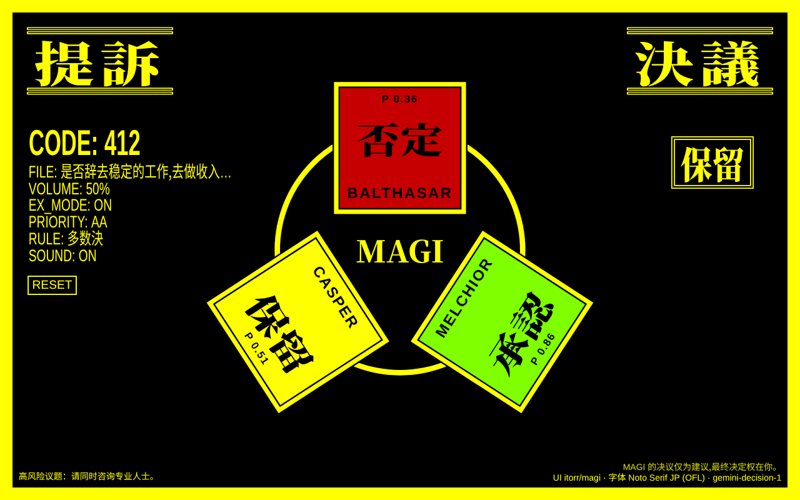

# magi-decision

EVA 风格的 MAGI 三贤人决议系统。MELCHIOR（科学家）、BALTHASAR（母亲）、CASPER（女人）三重人格各自对你的提案投票：一般议题少数服从多数，特别议案一票否决。

*An Evangelion-style MAGI decision system. Three personas, the scientist, the mother and the woman, vote on your proposal through Google's `gemini-decision-1`: majority rule for ordinary matters, a one-vote veto for critical ones.*



> 非官方同人项目，与 khara、GAINAX、Google 无关。MAGI 的决议只是建议，最终决定权在你。

## 特点

- **三重人格真的会分歧**：同一个模型靠三段人格描述投出不同的票。人格写法依据 TV 版第 12、13 集与旧剧场版中 MAGI 的表现，并用 65 个测试案件做了三轮验证（见 [`experiments/`](experiments/)）。
- **原作的表决制度**：
  - 一般议题多数决；
  - 自毁、牺牲生命这类特别议案需要三台全部承认，任何一台否决即否决；
  - 系统会自动判定一个提案是否属于特别议案，也可以手动强制。
- **原版界面**：fork 自 [itorr/magi](https://github.com/itorr/magi)，保留了八边形面板、闪烁与蜂鸣音效。原本只是装饰的配置项都有了实际作用：
  - Volume：宽容度；
  - Priority：表决规则；
  - EX_MODE：显示每台的承认概率。
- **按公开标准管理密钥**：
  - API Key 只存在于服务端；
  - 每次提交前自动扫描密钥；
  - 页面使用严格的 CSP；
  - 服务端不记录案件内容。

## 实验结果

决策模型只返回概率、不生成文字，所以人格之间能否形成"有意义的分歧"是项目成立的前提。三版人格模板在同一测试集上的表现（只用投票概率）：

| 指标 | 通过线 | v1 | v2 | v3（采用） |
| --- | --- | --- | --- | --- |
| 共识类最终结论正确率 | ≥ 95% | 95% | 95% | 100% |
| 冲突类分歧率 | ≥ 40% | 71% | 71% | 73% |
| 人格方向正确率 | ≥ 70% | 87% | 87% | 91% |
| 三台概率最大相关系数 | ≤ 0.80 | 0.81 | 0.75 | 0.75 |
| 改写翻转率 | ≤ 15% | 15% | 8% | 6% |

v3 中，CASPER 只听"此刻的心"：医生建议每天散步时，科学家和母亲承认，她否决。原作场景里，下令摧毁仍坐着驾驶员的兵器时，科学家和母亲承认，CASPER 否决，作为特别议案被她一票否决。完整报告见 [`experiments/reports/`](experiments/reports/)。

## 快速开始

需要 Node.js 18+ 和一个 [Google AI Studio](https://aistudio.google.com) 的 API Key。

```bash
git clone https://github.com/Mikamiteru10/magi-decision.git
cd magi-decision
npm install
npm run setup-hooks          # 开启提交前的密钥扫描
cp .dev.vars.example .dev.vars   # Windows 用记事本另存为 .dev.vars，填入开发用 Key
npm run dev                  # 打开 http://localhost:8787
```

在 `.dev.vars` 里设 `MOCK=1` 可以不调用 API、使用假数据调界面。

> Windows 的 PowerShell 默认禁止运行 npm 脚本，请在 cmd 里运行上述命令，或把 `npm` 写成 `npm.cmd`。

## 使用

- 点击画面或按 Enter：输入提案（写成"是否……？"），可补充背景。
- 有结果后点击或按空格：回到待机；再按一次用同一个提案重新审议。
- `Volume`：宽容度。50 为中立，65535 为强制可决。
- `Priority`：表决规则。
  - `AA`（默认）：自动，一般议题多数决，特别议案全会一致。
  - `A`：始终多数决。
  - `AAA`：强制一票否决。
  - `E`：任一台承认即可。
  - `+++`：三台概率取平均。
- `EX_MODE`：显示每台的承认概率。
- 调整 Volume 或 Priority 时结果即时重算，不会再次调用 API。

## 结构

| 路径 | 内容 |
| --- | --- |
| `public/` | 网页：`index.html`、`document.js`（交互）、`engine.js`（表决规则）、`_headers`（安全响应头） |
| `public/fonts/` | 标题字体子集（Noto Serif JP Black，SIL OFL 1.1） |
| `styles/document.less` | 样式源文件，编译为 `public/document.css` |
| `src/worker.js` | Cloudflare Worker：提供网页与 `POST /api/deliberate` |
| `src/personas.js` | v3 人格问题，由 `scripts/gen_personas.py` 从 `experiments/personas.py` 生成 |
| `experiments/` | P0 验证实验：测试案件、实验脚本、三版报告 |
| `scripts/` | 密钥扫描、人格生成、字体子集生成 |
| `test/` | 表决规则单元测试（`npm test`） |

## 部署

```bash
npx wrangler login
npx wrangler secret put GEMINI_API_KEY   # 线上专用 Key，不要与开发 Key 共用
npm run deploy                           # 先跑测试和密钥扫描，再发布
```

在加上人机验证和限流之前，建议用 Cloudflare Access 只允许自己访问。

## 修改人格

人格只在 `experiments/personas.py` 中修改。先用实验脚本验证，再运行 `python scripts/gen_personas.py v3` 同步到网页。

## 致谢与许可

- 代码：MIT，见 [LICENSE](LICENSE)。
- 界面：基于 [itorr/magi](https://github.com/itorr/magi)（MIT，© 2022 itorr），原许可见 [LICENSE-itorr-magi.txt](LICENSE-itorr-magi.txt)。
- 字体：[Noto Serif JP](https://fonts.google.com/noto/specimen/Noto+Serif+JP)（SIL OFL 1.1），见 [public/fonts/OFL-NotoSerifJP.txt](public/fonts/OFL-NotoSerifJP.txt)。原版使用的 Fontworks EVA 字体（マティスEB）不允许作为网页字体嵌入，因此没有包含在本仓库中。
- 决策模型：Google [Gemini Decisions API](https://blog.google/innovation-and-ai/technology/developers-tools/gemini-decisions-api/)（`gemini-decision-1`）。
- MAGI 设定：《新世纪福音战士》© khara。本项目为非官方同人作品，不包含任何官方图像。
